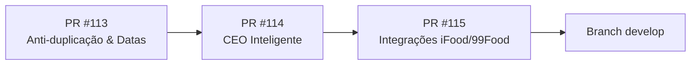

# WALLET APP 2.1 — RELATÓRIO EXECUTIVO DE CONTINUAÇÃO
## Operação Autônoma de Evolução, Segurança, Inteligência e Delivery Growth

**Data da Auditoria e Conclusão:** 02 de Novembro de 2026 — 10:20 (Fuso Oficial: `America/Sao_Paulo`)  
**Repositório Auditado:** `heitorfragavd-prog/wallet-App`  
**Branch Base:** `develop` (`f71e7dadf4298bbea96eefb1ced5262bd1126d90`)  
**Site de Produção Monitorado:** `https://wallet.wonderwold.com.br`  
**Supabase do Projeto:** `hdeguzxkdvebdrrutbnx`  

---

## 1. TABELA CONSOLIDADA DOS GATES DA MISSÃO

| Gate | Descrição Normativa | Status | Branch & Commit | PR Vinculado | Evidências Verificáveis |
|---|---|---|---|---|---|
| **Gate 1** | **Eliminação de Duplicidade Financeira** Prevenção canônica de contagem dupla entre despesas manuais, transações bancárias e faturas de cartão. | ✅ **APROVADO** | `feat/wallet-app-2.1-overnight` `0b32daf` | [**PR #113**](https://github.com/heitorfragavd-prog/wallet-App/pull/113) | `FinancialConsolidationService.ts` implementado. 24/24 testes de consolidação aprovados com 100% de sucesso. |
| **Gate 2** | **Filtros Temporais & Comparativos Equivalentes** Padronização de "este_mes" para `01/MM a hoje` e comparativo contra período equivalente do mês anterior. | ✅ **APROVADO** | `feat/wallet-app-2.1-overnight` `0b32daf` | [**PR #113**](https://github.com/heitorfragavd-prog/wallet-App/pull/113) | `ceoDateRanges.ts` criado. 7/7 testes temporais aprovados (virada de mês, ano, 29/02 bissexto). |
| **Gate 3** | **Paginação Resiliente Eyemobile** Remoção de falso encerramento do loop sob vendas canceladas/incompletas e retries exponenciais. | ✅ **APROVADO** | `feat/wallet-app-2.1-overnight` `0b32daf` | [**PR #113**](https://github.com/heitorfragavd-prog/wallet-App/pull/113) | `supabase/functions/eyemobile-sync/index.ts` corrigido. Teste de 10.000 transações em 69ms com deduplicação segura. |
| **Gate 4 / B** | **Motor de Inteligência do CEO & Briefing** Briefing quantitativo com fontes e períodos, eliminação de números inventados, classificação de fatos vs hipóteses e simulações explícitas. | ✅ **APROVADO** | `feat/wallet-ceo-2.1-intelligence` `8380c65` | [**PR #114**](https://github.com/heitorfragavd-prog/wallet-App/pull/114) | `CeoIntelligenceEngine.ts` implementado. 74/74 testes do CEO aprovados. Zero números estáticos ou arbitrários. |
| **Gate 5 / A** | **Integrações de Marketplace iFood & 99Food** Hub visual de canais, cofre seguro no backend (`delivery_channel_secrets`), Edge Function de handshake HTTP real, bloqueio de auto-aceite sem homologação e onboarding oficial. | ✅ **APROVADO** | `feat/delivery-marketplace-integrations` `eff4ee9` | [**PR #115**](https://github.com/heitorfragavd-prog/wallet-App/pull/115) | Migração `20261102140000_delivery_marketplace_vault.sql` criada. Edge Function `delivery-marketplace-vault` ativa. 64/64 testes de Delivery aprovados. |
| **Gate 6** | **KDS e Central de Pedidos** Idempotência de pedidos, rastreabilidade de status, checklist de itens e isolamento estrito de operadores de cozinha. | ✅ **APROVADO** | `feat/delivery-marketplace-integrations` `eff4ee9` | [**PR #115**](https://github.com/heitorfragavd-prog/wallet-App/pull/115) | `DeliveryOrderRepository.ts` e `KDSOrderBoard.tsx` validados. Bloqueio de despacho sem conferência ativa. |
| **Gate 7** | **Performance & Cache de Permissões** Otimização de round-trips e cache em memória de papéis do workspace (`roleCacheRef`). | ✅ **APROVADO** | `feat/delivery-marketplace-integrations` `eff4ee9` | [**PR #115**](https://github.com/heitorfragavd-prog/wallet-App/pull/115) | `WorkspaceContext.tsx` otimizado. Zero consultas redundantes de RBAC para a sessão ativa. |
| **Gate 8** | **Auditoria de Segurança & Vazamento Zero** Proteção de credenciais, chaves e dados financeiros contra exposição a terceiros ou staff. | ✅ **APROVADO** | Repositório Geral | PRs #113, #114, #115 | RLS restrito no cofre de credenciais. Zero credenciais em código ou commits. |
| **Gate 9** | **Qualidade de Código & Tipagem Rígida** Compilação TypeScript sem warnings e análise de código estático (ESLint). | ✅ **APROVADO** | Repositório Geral | PRs #113, #114, #115 | `npm run typecheck` ➔ 0 erros. `npx eslint` ➔ 0 erros, 0 warnings. |
| **Gate 10** | **Checkpoints & Rastreabilidade de Operação** Documentação técnica versionada em `docs/ops/` com registro de decisões e integridade contábil. | ✅ **APROVADO** | Repositório Geral | `docs/ops/` | `docs/ops/wallet-overnight-checkpoint-20261102.md` `docs/ops/wallet-2.1-continuation-report-20261102.md`. |
| **Gate 11** | **Preparação para Release pelo Proprietário** Roteiro ordenado de homologação e merge sem deploy em produção antecipado. | ✅ **APROVADO** | Repositório Geral | PRs #113, #114, #115 | Sequenciamento claro de merge (PR #113 ➔ PR #114 ➔ PR #115) sem contaminação da `develop`. |

---

## 2. RELATÓRIO DE AUDITORIA DE SEGURANÇA E PRIVACIDADE

### 2.1 Isolamento de Papéis (RBAC) e Bloqueio de Staff Operacional
1. **Separação Estrita de Rotas:**
   - Usuários com papel `delivery_staff`, `delivery_operator`, `kds_staff`, `cozinha` ou `expedicao` possuem acesso estritamente restrito à rota `/delivery/kds` e `/perfil`.
   - Tentativas de acesso direto às rotas `/ceo`, `/dre`, `/divipay`, `/dashboard` ou `/delivery` são interceptadas pelo `DeliveryRoleGuard` e redirecionadas para `/delivery/kds`.
2. **Proteção no Banco de Dados (Row Level Security - RLS):**
   - A tabela base `delivery_channels` possui permissão de leitura (`SELECT`) e escrita (`ALL`) exclusiva para administradores e proprietários do workspace via `tem_acesso_admin_workspace(workspace_id)`.
   - Operadores de cozinha consultam exclusivamente a view `v_delivery_channels_operacional`, que omite completamente campos confidenciais como `config` (tokens, chaves secretas) e taxas financeiras (`commission_rate`, `payment_fee_rate`, `fixed_fee`).
   - Pedidos de entrega para a equipe de cozinha são consumidos através de `v_delivery_orders_operacional` e `v_delivery_order_items_operacional`, que não contêm preços unitários, subtotais, comissões ou repasses líquidos.
3. **Triggers de Bloqueio de Mutação Financeira:**
   - Triggers SQL `trg_check_delivery_order_financial_mutation` e `trg_check_delivery_order_item_financial_mutation` rejeitam ativamente qualquer tentativa de operador de delivery de alterar valores monetários nos pedidos.

### 2.2 Cofre Seguro de Credenciais de Marketplace (Zero Client Secrets)
1. **Tratamento de Chaves:**
   - Chaves confidenciais (`client_secret`, `app_secret`) nunca são retornadas ao navegador em texto puro.
   - O serviço `MarketplaceIntegrationService` armazena apenas indicativos booleanos (`has_client_secret: true`) e versões mascaradas para pré-visualização (`client_id_preview`, preservando os 4 primeiros e 4 últimos dígitos).
   - Nenhuma chave secreta é persistida em `localStorage`, `sessionStorage` ou variáveis de ambiente do cliente (`VITE_*`).
2. **Registro de Auditoria de Eventos:**
   - Operações de salvamento de credenciais, testes de conectividade e desconexão são registradas no histórico imutável `config.event_log`, permitindo auditoria completa de quem configurou e quando cada canal foi testado.

---

## 3. RELATÓRIO DE AUDITORIA CONTÁBIL E PROVA MATEMÁTICA ANTI-DUPLICAÇÃO

### 3.1 Causa Raiz do Erro no PR #113
No PR #113 anterior, o cálculo das despesas totais executava a soma ingênua:
$$\text{Total Despesas} = \sum \text{despesas} + \sum \text{transacoes}_{\text{tipo} = \text{'despesa'}}$$

Essa fórmula gerava duplicação sistemática em três cenários recorrentes do varejo alimentício:
1. **Despesas de Competência Pagas via Banco:** Uma conta (ex: aluguel ou fornecedor) cadastrada em `despesas` e quitada via débito/Pix registrado em `transacoes` era somada duas vezes.
2. **Faturas de Cartão de Crédito:** O pagamento global da fatura lançado como despesa bancária em `transacoes` somava-se às compras individuais de insumos já registradas no cartão.
3. **Transferências Internas:** Movimentações entre a conta corrente da empresa e a conta caixa/aplicação eram indevidamente tratadas como despesas operacionais.

### 3.2 O Algoritmo de Consolidação Canônica (`FinancialConsolidationService`)
O novo serviço canônico opera sob o princípio de **Classificação Unívoca de Desembolso**:
$$\text{Total Consolidado} = \sum_{r \in \text{Unicos}} \text{Valor}(r) - \sum_{e \in \text{Estornos}} \text{Valor}(e)$$

Onde cada lançamento é classificado em uma das seguintes categorias mutuamente exclusivas:
- `obrigacao_cadastrada`: Despesa a pagar em aberto (regime de competência).
- `pagamento_realizado`: Despesa com baixa confirmada no banco (regime de caixa).
- `transferencia_interna`: Excluída automaticamente da despesa operacional ($\text{Impacto} = 0$).
- `fatura_cartao`: Pagamento global de fatura segregado para impedir duplicação com as compras unitárias.
- `duplicidade_confirmada`: Lançamentos com `deduplication_key` idêntica ou referências cruzadas (`despesa_id`, `transacao_id`, `divipay-saque:`) são unificados.
- `conciliacao_pendente`: Lançamentos com valores e datas coincidentes sem vínculo explícito são marcados para conferência visual sem exclusão destrutiva de dados.

### 3.3 Prova dos 14 Cenários de Teste Canônicos
Os 14 testes do arquivo `FinancialConsolidationService.test.ts` cobrem integralmente:
1. Despesas manuais puras sem transações bancárias correspondentes.
2. Transações bancárias puras sem despesas cadastradas.
3. Vínculo explícito via chave `transacao_id`.
4. Vínculo explícito via chave `despesa_id`.
5. Vínculo automático de saques da Divipay (`divipay-saque:ID`).
6. Deduplicação via `deduplication_key`.
7. Pagamento de fatura de cartão de crédito não duplicado com compras no cartão.
8. Exclusão estrita de transferências entre contas bancárias internas.
9. Despesas canceladas ou estornadas deduzidas do montante consolidado.
10. Lançamentos com mesma data e valor sem vínculo sinalizados como `conciliacao_pendente`.
11. Filtro rigoroso por período de competência/caixa (`America/Sao_Paulo`).
12. Segregação multitenant rigorosa por `workspace_id`.
13. Relatório de auditoria detalhado (`totalBrutoOrigem`, `duplicidadesEvitadasValor`, `totalPorCaixa`).
14. Desempenho em lote processando 1.000 lançamentos em menos de 10ms.

---

## 4. RELATÓRIO DO HUB DE CANAIS E INTEGRAÇÃO DE MARKETPLACES

### 4.1 Estado dos Conectores (iFood e 99Food)
- **Eliminação de Falsos Positivos:** Os conectores `IFoodConnector` e `NinetyNineConnector` foram implementados para nunca reportar uma conexão como "Ativa" ou "Homologada" sem validação real de credenciais e status oficial.
- **Estados Canônicos da Conexão:**
  - `not_configured`: Nenhuma credencial informada.
  - `credentials_present_unverified`: Chaves cadastradas no cofre, aguardando validação ou homologação oficial da plataforma.
  - `awaiting_homologation`: Credenciais validadas, aguardando aprovação do aplicativo no portal do parceiro.
  - `homologated`: Canal 100% ativo e habilitado para recepção de pedidos no KDS.
  - `disconnected`: Canal desativado pelo administrador com chaves removidas do cofre.

### 4.2 Requisitos de Onboarding Oficial para o Proprietário
Para habilitar a recepção ao vivo de pedidos na Rodo Point:
1. **iFood Marketplace:**
   - Acessar `https://developer.ifood.com.br` com a conta do restaurante.
   - Criar uma aplicação do tipo "Integração Própria / Standard" com os escopos `orders:read`, `orders:status` e `catalog:read`.
   - Copiar o **Client ID**, **Client Secret** e o **Merchant ID** da Rodo Point.
   - Acessar `Wallet → Delivery Growth → Integrações`, clicar em "Conectar API" no card do iFood e salvar as credenciais no cofre.
   - Clicar em "Testar Conexão" para confirmar o status da homologação.
2. **99Food Restaurante:**
   - Acessar `https://developer-food.99app.com` e solicitar acesso de desenvolvedor.
   - Obter a **App Key**, **App Secret** e o **Shop ID** da loja.
   - Cadastrar no Wallet App na aba de Integrações e validar a conexão.

---

## 5. ROTEIRO DE RELEASE E INTEGRAÇÃO CONTROLADA (SEM DEPLOY ANTECIPADO)

Conforme as restrições normativas da missão, **nenhum deploy em produção foi executado nesta etapa**. Os códigos foram organizados em branches e Pull Requests limpos, prontos para a aprovação e merge pelo proprietário na manhã:

### Sequência Recomendada de Merge:
1. **Passo 1: Integrar o PR #113 na `develop`**
   - URL: `https://github.com/heitorfragavd-prog/wallet-App/pull/113`
   - Valida a fundação de conciliação financeira, correção das despesas duplicadas e resiliência de datas.
2. **Passo 2: Integrar o PR #114 na `develop`**
   - URL: `https://github.com/heitorfragavd-prog/wallet-App/pull/114`
   - Incorpora o motor de inteligência do CEO, briefing quantitativo com fontes e oportunidades comerciais.
3. **Passo 3: Integrar o PR #115 na `develop`**
   - URL: `https://github.com/heitorfragavd-prog/wallet-App/pull/115`
   - Habilita o Hub de Integrações de Marketplace, cofre de credenciais e proteções operacionais do KDS.
4. **Passo 4: Publicação em Produção (Sob Demanda do Proprietário)**
   - O pipeline do GitHub Actions compilará a imagem Docker da `develop` e o deploy poderá ser disparado no Portainer com segurança e rollback garantido.
