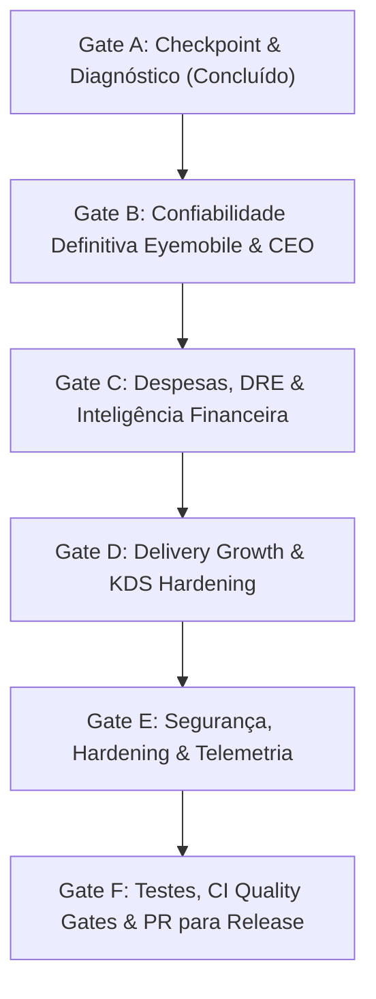

# Operação Madrugada — Wallet App 2.1
## Checkpoint e Diagnóstico Objetivo (Gate A)

**Data e Hora:** 2026-11-02 01:25 (America/Sao_Paulo)  
**Ambiente:** Desenvolvimento / Homologação Rodo Point  
**Repositório:** `heitorfragavd-prog/wallet-App`  
**Branch Base:** `develop`  
**Branch da Operação:** `feat/wallet-app-2.1-overnight`  
**SHA Inicial:** `f71e7dadf4298bbea96eefb1ced5262bd1126d90` (Merge PR #112)  

---

### 1. Estado Atual e Funcionalidades Concluídas

Com a integração dos PRs #108, #110, #111 e #112, os seguintes marcos foram atingidos com 100% de aprovação nos Quality Gates:
- **Resolução do erro Date.UTC:** Fórmulas corrigidas para operar com timestamps numéricos e fuso horário canônico `America/Sao_Paulo`.
- **Alinhamento Chat vs. Painel:** Padronização matemática da métrica "Vendas de ontem" no dia civil oficial (00:00:00 a 23:59:59 `America/Sao_Paulo`), isolando o turno estendido de madrugada.
- **Série Diária de Vendas (`dailySales`):** Geração determinística de barras diárias com garantia de equivalência $\sum \text{dailySales.total} \equiv \text{totalRevenue}$.
- **Contagem Agregada de Itens (`totalItemsSold`):** Eliminação do limitador de Top 10 para o card de volume total, somando todos os itens das transações auditadas.
- **Isolamento de CMV e Margens:** Eliminação de margem operacional de 100% artificial; exibição honesta de "Não apurado" quando despesas totalizam R$ 0,00.
- **Separação Contábil:** Segregação entre vendas brutas de PDV (Eyemobile), conciliação bancária (`transacoes`), repasses líquidos (Divipay) e contas a pagar (`despesas`).

---

### 2. Riscos e Fragilidades Identificados

1. **B.1 — Cobertura Parcial de Itens no Eyemobile:**
   - Atualmente, `totalItemsSold` assume que se a soma for positiva, o dado é representativo. Caso a API retorne transações parciais (ex: metade das vendas com array `items` e metade sem itens detalhados), o total exibido seria uma soma parcial sem aviso ao gestor.
   - *Mitigação:* Implementar contrato de cobertura (`'complete' | 'partial' | 'unavailable'`) calculando `coverageRatio` (% de pedidos com detalhamento).
2. **B.2 — Integridade Temporal de Vendas sem Timestamp Válido:**
   - Em caso de transação com data corrompida ou inválida, atribuí-la ao primeiro dia causaria distorção contábil.
   - *Mitigação:* Segregar vendas não classificadas em `unclassifiedRevenue` / `unclassifiedCount`, exibindo na série diária somente vendas com data verificável e expondo a taxa de conciliação temporal.
3. **B.3 — Paginação e Resiliência sob Grandes Volumes:**
   - Lojas com alto volume de vendas (> 10.000 transações/mês) exigem paginação robusta, controle de rate limit e timeouts seguros.
   - *Mitigação:* Testes de carga simulados com 1.000, 5.000 e 10.000 vendas, garantindo que o algoritmo de agregação seja $O(N)$ em tempo e memória sem congelamento da thread.
4. **C.1 & C.2 — Semântica de Despesas Zeradas e DRE:**
   - Um valor de R$ 0,00 de despesas pode significar ausência de despesas ou falta de lançamentos no período.
   - *Mitigação:* Auditoria somente leitura no Supabase para diagnosticar `despesas` e padronização semântica transparente ("R$ 0,00 lançado" vs. "Módulo não preenchido / Não apurado").
5. **D & E — Governança Operacional e Segurança:**
   - Garantir que operadores KDS (`delivery_staff`) continuem bloqueados de qualquer rota e Edge Function financeira, e que canais não homologados não emitam telemetria falsa.

---

### 3. Ordem de Execução das Fases

---

### 4. Limites de Segurança e Regras da Missão

- **Sem deploy em produção nesta missão:** Todas as melhorias serão integradas e testadas em branch própria (`feat/wallet-app-2.1-overnight`), com PR aberto contra `develop` para autorização do proprietário pela manhã.
- **Preservação de Dados e Backups:** Nenhuma migração destrutiva (`DROP TABLE`, `TRUNCATE`) e nenhum arquivo untracked de backup será removido.
- **Sigilo de Credenciais:** Nenhuma chave de API ou credencial exposta em commits, artefatos ou mensagens.
